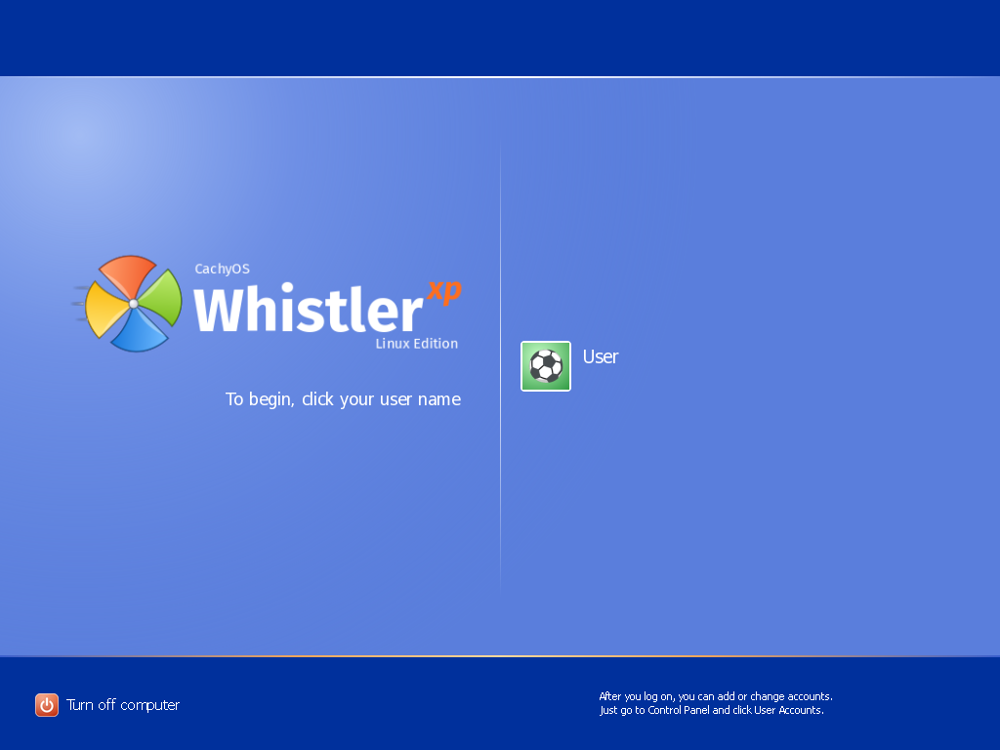
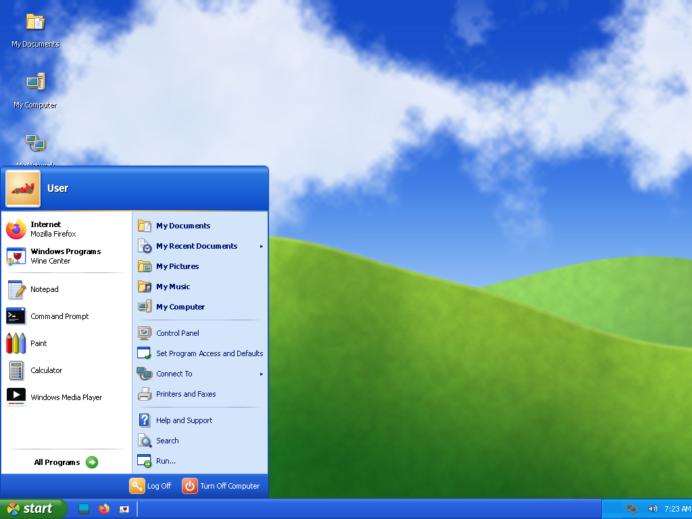
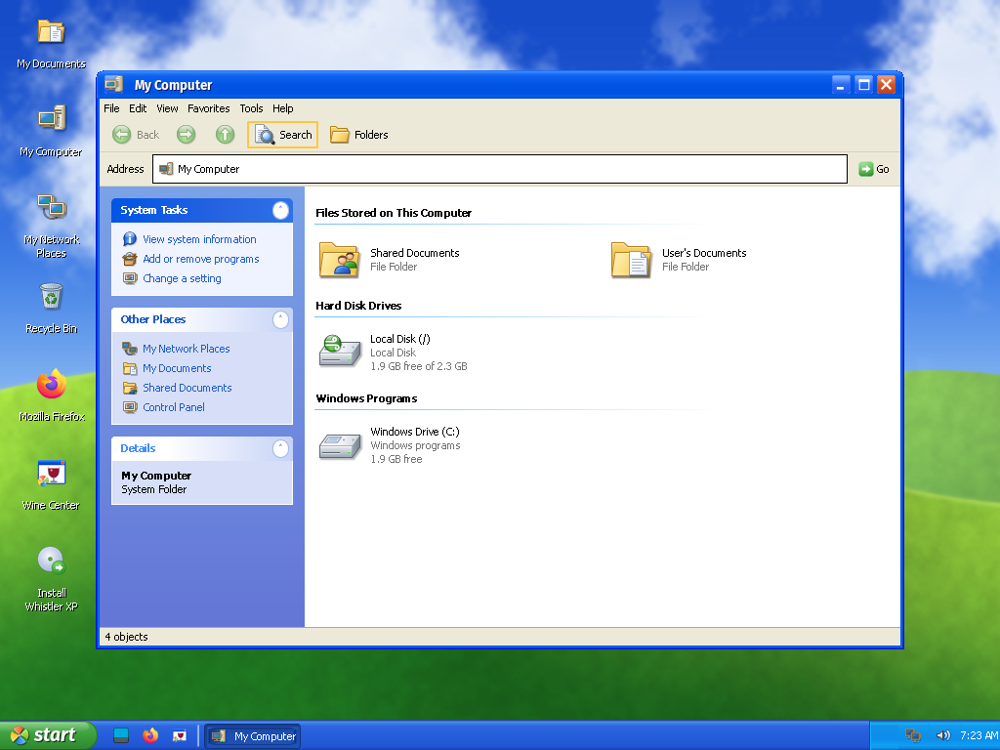
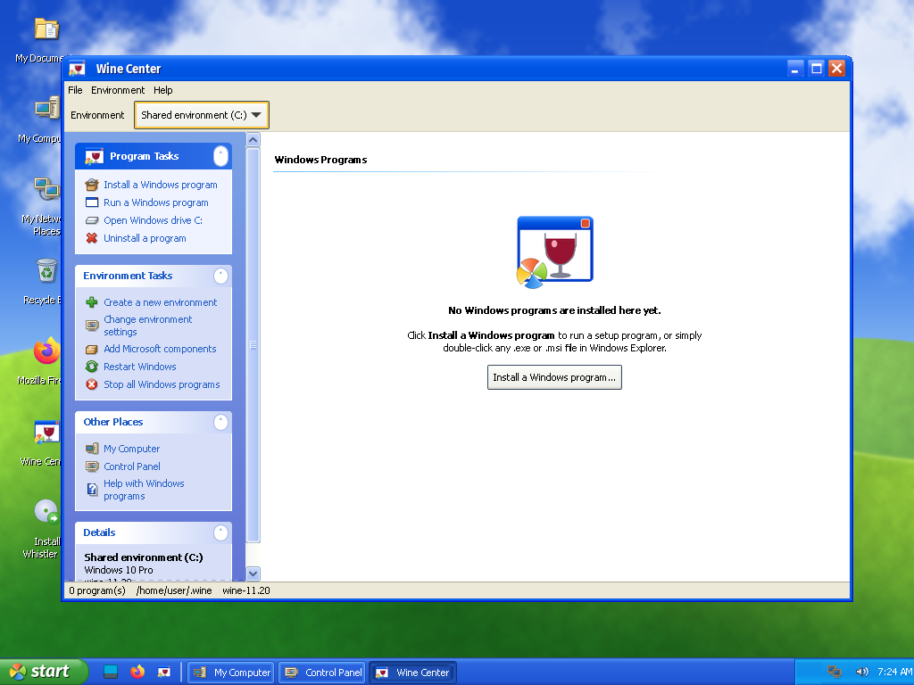

# Whistler XP

**It's 2001 again.** Whistler XP is a just-for-fun Linux distribution that does its best
impression of Windows XP: the green start button, the blue taskbar, the rolling green hills,
the "To begin, click your user name" Welcome screen, and Windows programs that install with a
double-click. Under the hood it's a perfectly modern CachyOS system wearing a very nostalgic
costume.

It's a hobby project made for fun and nostalgia. No roadmap, no support contract, no warranty,
and no promise that it won't make you want to download Winamp again.

| | |
| --- | --- |
|  |  |
|  |  |

## What's in the box

- **The desktop you remember**: two-column Start menu with All Programs cascades, blue
  taskbar and notification area, XP-style window frames, icons and pointers, a rolling-hills
  wallpaper, and startup/logon/logoff sounds.
- **The shell bits**: Welcome screen with user tiles, boot splash with the sliding progress bar,
  Turn Off / Log Off dialogs over a desktop that fades to grey, Run, My Computer, Control Panel
  (category and classic views), System Properties, User Accounts, Add or Remove Programs, Volume
  Control, Help and Support, Command Prompt, and of course Minesweeper.
- **Windows programs**: Wine 11 (with Mono and Gecko), winetricks, DXVK and VKD3D-Proton, plus
  **Wine Center**, an XP-style front end that installs programs, keeps separate Windows
  environments, adds Microsoft runtimes (VC++, .NET, DirectX…) and uninstalls things.
  Double-click any `.exe` or `.msi` and installed programs show up in Start ▸ All Programs.
- **Setup**: an XP-style installer, from the blue text-mode screen to the graphical Setup with
  the steps sidebar. It installs to a whole disk (UEFI or BIOS) and **erases that disk**.

Everything in the base system (bitmaps, icons, pointers, wallpaper, sounds, the pinwheel logo)
is original or openly licensed. There are no Microsoft files in this repository or in the ISO
it builds.

## Bring your own Bliss

Want the real thing: the actual Luna bitmaps, Bliss, Tahoma, and *that* startup sound? The
optional **whistler-xp-originals** add-on imports them from **your own** Windows XP CD image.
It's only scripts; it downloads nothing and ships nothing from Microsoft. Removing it brings the
lookalikes back.

Control Panel ▸ Appearance and Themes ▸ *Use the original Windows XP artwork and sounds*, or
from a terminal:

```bash
sudo pacman -S whistler-xp-originals
```

```bash
sudo whistler-import-xp --cli XP_ISO
```

`XP_ISO` is the path to your XP CD image (`.iso`); a mounted CD or a `WINDOWS` folder from an
old disk works too. Run `whistler-import-xp` without `--cli` for the wizard.

## Build it

You need an x86_64 machine with Docker (Linux), or macOS with [Colima](https://github.com/abiosoft/colima).
On macOS the build uses its own Colima profile `winxp` stored in `./colima`, so it leaves your
other VMs and Docker context alone. Apple Silicon works but emulates x86_64, so bring a snack.

```bash
./build.sh                 # packages + ISO -> out/whistler-xp-*.iso
```

```bash
./build.sh clean           # drop the build caches inside the build VM
```

Options: `--fast` (lighter compression), `--debug` (sshd with a generated key in `test/ssh/`).
Stages: `./build.sh packages [name…]`, `./build.sh iso`.

### Try it in a VM

```bash
./build.sh --fast --debug && test/run-vm.sh
```

`test/run-vm.sh` boots the newest ISO with QEMU (HVF, KVM or TCG; `--bios` for legacy boot) and
serves the screen over VNC on `127.0.0.1:5901`. The live session logs in as **User** with no
password, just like a fresh XP box with one account. `test/ssh.sh` gives a root shell in debug
builds and `test/push.sh` hot-syncs Python/CSS changes into the running VM.

### Building on another machine

`remote/` runs the build and test VM on another host over SSH. Set `WHISTLER_REMOTE` to its ssh
name (or put it in the git-ignored `remote/local.env`), then use `remote/sync` to copy the tree,
`remote/mp '<commands>'` to run commands there, `remote/vm start|stop|status` for the test VM
and `remote/tunnel` to forward its VNC and SSH ports.

## Layout

| Path | What |
| --- | --- |
| `packages/whistler-artwork` | Theme "Whistler": generated bitmaps (`gen/`), original icons (`icons/src`) and pointers, wallpaper, sounds, logo, boot splash |
| `packages/whistler-desktop` | Session, Xfce defaults, start button and tray panel plugins (C), the XP apps (Python/GTK 3) |
| `packages/whistler-xp-originals` | Optional importer for your own XP files |
| `profile/` | archiso profile: CachyOS repos and kernel, live user, boot menus |
| `test/` | QEMU runner and VNC/SSH helpers |
| `NOTES.md` | Design decisions, what's been tested, known gaps |

## FAQ

**Is this Windows?** No. It's Linux (CachyOS) with Xfce underneath and a lot of XP-flavoured
code on top. Windows programs run through Wine, so some will work beautifully and some won't.

**Should I put this on my work laptop?** Probably not. It's a toy. A fun, blue, nostalgic toy.

**Why "Whistler"?** It was Windows XP's codename before it shipped.

**Where's Clippy?** Wrong Office. Also, wrong decade for a reunion.

## Credits

Built on [CachyOS](https://cachyos.org) and [Arch Linux](https://archlinux.org) with
[archiso](https://gitlab.archlinux.org/archlinux/archiso), [Xfce](https://xfce.org) and
[Wine](https://www.winehq.org). The GTK stylesheet started from
[B00merang's Windows XP theme](https://github.com/B00merang-Project/Windows-XP) (GPL-3.0); its
bitmaps aren't used, every image here is drawn from scratch.

## License

[GPL-3.0-or-later](LICENSE).

Whistler XP is an unofficial fan project and isn't affiliated with, endorsed by or sponsored by
Microsoft. Windows and Windows XP are trademarks of Microsoft Corporation, used here only to
describe what this project imitates.
